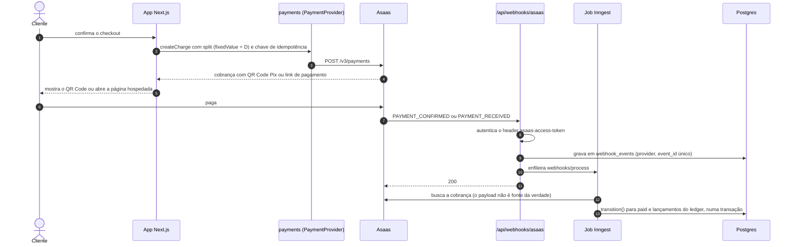
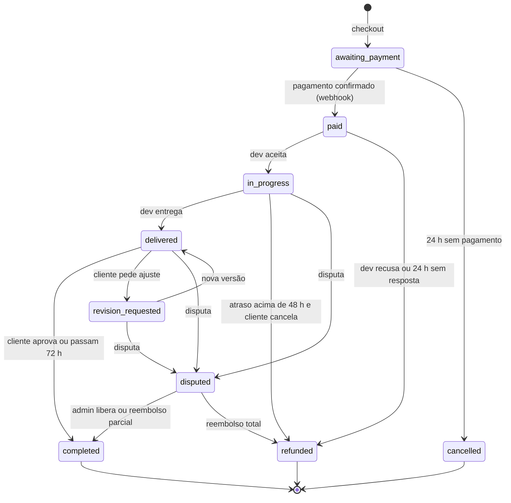

# Plano e Especificação Técnica — Marketplace de Serviços Digitais

> Cópia em Markdown do doc [Plano e Especificação Técnica](https://claude.ai/artifact/G7suxKUZ9aLqFXzyK1Ej1N), gerada em 24/10/2026. Os diagramas do doc aparecem aqui em Mermaid. Ao mudar uma regra, atualize o doc e este arquivo e registre a decisão em `docs/decisions/`.

## 1. Como usar este documento com o Claude Code

Este doc é a especificação que o Claude Code segue para construir a plataforma, uma fase por vez. No repositório ele fica em `docs/SPEC.md`, e o `CLAUDE.md` na raiz aponta para ele.

1. Salve o `CLAUDE.md` na raiz do repositório e a versão em Markdown deste doc em `docs/SPEC.md` (os dois arquivos acompanham este doc).
2. Peça uma fase por vez, por exemplo: "Leia docs/SPEC.md e implemente a Fase 1. Mostre o plano antes de escrever código."
3. Revise o plano, aprove e deixe o Claude Code rodar os testes da fase.
4. Avance só quando os critérios de aceite da fase passarem (seção 4).
5. Toda decisão nova vira um registro curto em `docs/decisions/` e atualiza esta spec.

As seções 8 (gateway), 9 (webhooks) e 10 (segurança) são regras, não sugestões: mudar qualquer item delas exige uma decisão registrada.

## 2. Visão geral do produto

A plataforma vende serviços digitais entregues por devs independentes: ela intermedeia a venda, segura o pagamento em custódia até a aprovação e fica com uma taxa. Toda a receita vem de clientes pagando por trabalho entregue.

| Ator | O que faz | Como entra |
| --- | --- | --- |
| Cliente | Compra um pacote, acompanha a entrega, aprova ou pede revisão, avalia | Cadastro com e-mail ou Google |
| Dev | Publica pacotes, entrega, responde no chat, recebe o repasse | Cadastro, aprovação da curadoria e conta de recebimento no gateway (KYC) |
| Admin / curador | Aprova devs e pacotes, media disputas, acompanha o financeiro | Convite interno, 2FA obrigatório |

**Modelo de receita (valores iniciais, configuráveis no painel)**

- Taxa da plataforma descontada do dev no split: 15% no primeiro pedido entre um cliente e um dev, 10% a partir do segundo e 5% depois de R$ 15.000 acumulados entre os dois.
- Taxa extra do cliente: desligada no MVP.
- Indicação de um nível (Fase 5): quem indica recebe 20% da taxa da plataforma nos pedidos aprovados do indicado por 12 meses. Sem níveis, sem compra para participar.

**Princípios**

- O dinheiro do cliente só chega ao dev depois da aprovação, manual ou automática.
- Todo centavo passa pelo ledger; saldo nunca é um campo editável.
- Escopo, prazo e número de revisões ficam escritos no pacote antes da compra.

## 3. Escopo do MVP

O MVP vende pacotes fechados de um único nicho, em reais, para clientes no Brasil, com Pix e cartão. Tudo o que não serve a esse fluxo fica para depois.

**Entra no MVP**

- Catálogo de pacotes com até três níveis (Básico, Padrão, Premium), cada um com escopo, prazo, número de revisões e preço
- Cadastro e login de clientes, devs e admins; aprovação de devs e de pacotes pela curadoria
- Checkout com Pix e cartão à vista, com split e custódia no gateway
- Pedido com chat, briefing, envio da entrega (arquivos e links), aprovação, pedido de revisão e aprovação automática
- Disputa mediada pelo admin, com três desfechos: liberar ao dev, reembolso parcial ou reembolso total
- Repasse ao dev pelo gateway, extrato do dev e painel financeiro do admin
- Avaliação de 1 a 5 com comentário após a conclusão
- E-mails transacionais e notificações no app

**Fica para depois**

- Projetos sob medida com propostas (Fase 6)
- Programa de indicação (Fase 5)
- Clientes no exterior, outras moedas e gateway internacional (Fase 6)
- Parcelamento, boleto, assinaturas e pacotes recorrentes
- App mobile nativo e busca com IA

## 4. Roadmap de construção

São sete fases, e cada uma termina num portão com critério verificável. O piloto com clientes reais acontece depois da Fase 4, antes de abrir para o público.

Entregáveis e portão de cada fase:

1. **Fase 0, Fundação.** Repositório, CI, Supabase local e na nuvem, Next.js com Tailwind e shadcn/ui, autenticação, papéis, RLS base, logger, Sentry, `CLAUDE.md` e `docs/SPEC.md`. **Portão:** CI verde, deploy de preview no ar, login com papéis e teste de RLS passando.
2. **Fase 1, Contas e catálogo.** Perfis, onboarding do dev com subconta e KYC no sandbox do Asaas, escrow configurado na subconta, pacotes com três níveis, curadoria e páginas públicas com SEO. **Portão:** dev aprovado publica pacote, visitante vê a página e dev sem KYC não consegue publicar.
3. **Fase 2, Checkout e custódia.** `PaymentProvider` e adaptador Asaas, cobrança Pix e cartão com split, caixa de entrada de webhooks, ledger, estados até `paid` e conciliação diária. **Portão:** um pagamento no sandbox gera um único lançamento mesmo com o webhook entregue três vezes, e a conciliação não acusa divergência.
4. **Fase 3, Execução do pedido.** Aceite, chat, entregas com versões, revisões, aprovação manual e automática, liberação da garantia, disputa e estornos. **Portão:** os quatro fluxos ponta a ponta passam (aprovação, revisão, disputa com reembolso parcial e reembolso total) e o ledger fecha em todos.
5. **Fase 4, Saques e financeiro.** Webhook de validação de saque, extrato do dev, painel financeiro do admin, NFS-e da taxa, avaliações, e-mails transacionais e páginas legais. **Portão:** saque acima do saldo é recusado, a revisão de segurança da seção 10 está concluída e os termos foram aprovados pelo jurídico.
6. **Piloto.** De 5 a 10 devs convidados, de 3 a 5 pacotes e meta de 20 a 30 pedidos pagos antes de abrir para o público.
7. **Fase 5, Crescimento.** Indicação de um nível, taxa decrescente automática por par cliente e dev, busca e SEO por categoria. **Portão:** as comissões de indicação batem com o ledger em todos os pedidos do mês.
8. **Fase 6, Internacional e sob medida.** Stripe para clientes no exterior (entidade a definir), preços em dólar e projetos sob medida com propostas. **Portão:** jurisdição da empresa decidida com assessoria tributária (seção 14).

## 5. Arquitetura

A plataforma é um monólito modular em TypeScript (Next.js + Postgres), com o gateway atrás de uma interface própria. Webhooks entram numa caixa de entrada e são processados por jobs, nunca dentro da requisição.

Caminho de um pagamento (o dinheiro só muda de estado quando a confirmação volta pelo webhook):



O app só pede a cobrança; quem muda o pedido para pago é o job que processa o webhook, numa transação única com o ledger.

| Camada | Escolha | Por quê |
| --- | --- | --- |
| Linguagem | TypeScript em modo strict | Um idioma só no front, no back e nos jobs |
| App web e API | Next.js (App Router), Route Handlers e Server Actions | SSR para SEO do catálogo, deploy simples |
| Interface | Tailwind CSS + shadcn/ui (Radix) | Componentes acessíveis e fáceis de adaptar |
| Banco | PostgreSQL gerenciado (Supabase, região São Paulo) + Drizzle ORM | RLS nativo e migrações em SQL versionado |
| Autenticação | Supabase Auth (e-mail, link mágico, Google) + TOTP para admin | Integra com RLS |
| Arquivos | Supabase Storage com buckets privados e URLs assinadas | Entregas nunca ficam públicas |
| Jobs e filas | Inngest (funções duráveis, retries, cron) | Webhooks, aprovação automática, conciliação |
| E-mail | Resend | Transacionais com templates em React |
| Pagamentos | [Asaas](https://docs.asaas.com/docs/split-para-contas-com-conta-escrow) no MVP; Stripe na fase internacional | Ver seção 8 |
| Observabilidade | Sentry + logs estruturados (pino) | Erros e rastreio por pedido |
| Hospedagem | Vercel (app), Supabase (dados), Inngest Cloud (jobs) | Nenhum servidor para manter |

**Módulos de domínio** (cada um em `src/modules/<nome>`, com `domain/`, `application/` e `infra/`)

- `accounts`: usuários, papéis, perfis de dev, status de KYC
- `catalog`: categorias, pacotes, níveis e curadoria
- `orders`: pedido, máquina de estados, chat, entregas e revisões
- `payments`: interface `PaymentProvider`, adaptadores Asaas e Stripe, cobranças, custódia, estornos e repasses
- `ledger`: lançamentos de dupla entrada e saldos derivados
- `webhooks`: caixa de entrada, verificação de autenticidade e despacho para handlers
- `disputes`, `reviews`, `notifications`, `admin` e `referrals` (Fase 5)

**Regras de dependência**

- A UI chama só a camada `application`; nada de SQL em componentes.
- Um módulo não lê tabelas de outro; usa a API pública dele (`index.ts`).
- Só o módulo `payments` fala com o gateway; o resto usa `PaymentProvider`.
- Só o módulo `ledger` escreve em `ledger_entries`.

**Estrutura de pastas**

```
src/app/          rotas e páginas (Next.js)
src/modules/      domínios listados acima
src/lib/          money, ids, auth, erros, logger
src/jobs/         funções Inngest
db/migrations/    SQL versionado
tests/            unit, integração, e2e
docs/             SPEC.md e decisions/
```

**Decisões registradas**

- ADR-001: monólito modular em vez de microsserviços, porque o time é pequeno e há um deploy só.
- ADR-002: Postgres com RLS como segunda barreira de autorização, além das checagens na aplicação.
- ADR-003: Asaas no MVP por reunir split, subcontas e conta escrow no mesmo provedor.
- ADR-004: ledger de dupla entrada como fonte da verdade do dinheiro.
- ADR-005: webhook vira registro na caixa de entrada e é processado por job, nunca na requisição.
- ADR-006: papel em `public.users` por trigger; admin só por convite (service key) e com TOTP (`aal2`).
- ADR-007: `withUser`/`withService` para acesso a dados, fronteira de módulo no lint e migrações SQL com checksum.

## 6. Modelo de dados

O estado do negócio fica em tabelas normais e todo o dinheiro passa por um ledger de dupla entrada que só aceita inserções. Saldo nunca é coluna editável: é a soma dos lançamentos.

**Convenções**

- Dinheiro em centavos (`bigint`) com coluna `currency` (ISO 4217, `BRL` no MVP). Nunca `float`.
- Taxa em basis points (`fee_bps`), arredondada para o centavo; a parte do dev é `total − taxa`, para a soma sempre fechar.
- IDs UUID v7 gerados na aplicação; datas em `timestamptz` (UTC), exibidas em America/Sao_Paulo.
- Todo pedido guarda um `snapshot` do pacote comprado (escopo, prazo, revisões, preço). Editar o pacote não altera pedidos existentes.
- `order_events`, `ledger_entries`, `webhook_events` e `audit_log` são append-only: UPDATE e DELETE bloqueados por trigger e por RLS.
- Toda tabela com dado de usuário tem RLS ligada; acesso de admin passa por funções auditadas.

| Tabela | Para que serve | Campos-chave |
| --- | --- | --- |
| `users` | Conta e papel | `id`, `email`, `role` (client, dev, admin), `mfa_enabled` |
| `dev_profiles` | Perfil público e financeiro do dev | `user_id`, `status` (pending, approved, suspended), `provider_account_id`, `wallet_id`, `kyc_status` |
| `categories` | Nichos do catálogo | `slug`, `name` |
| `packages` | Serviço publicado | `dev_id`, `category_id`, `title`, `status` (draft, in_review, published, paused) |
| `package_tiers` | Básico, Padrão, Premium | `package_id`, `tier`, `price_cents`, `delivery_days`, `revisions`, `scope_md` |
| `orders` | Pedido e estado atual | `client_id`, `dev_id`, `tier_id`, `snapshot`, `status`, `amount_cents`, `fee_bps`, `platform_fee_cents`, `dev_amount_cents`, `due_at`, `auto_approve_at` |
| `order_events` | Linha do tempo e auditoria do pedido | `order_id`, `type`, `actor_id`, `from_status`, `to_status`, `payload` |
| `messages` | Chat do pedido | `order_id`, `sender_id`, `body`, `attachments` |
| `deliveries` | Versões de entrega | `order_id`, `version`, `note`, `files` |
| `payments` | Cobrança no gateway | `order_id`, `provider`, `provider_payment_id` (único por provedor), `method`, `status`, `gross_cents`, `net_cents`, `escrow_id` |
| `refunds` | Estornos totais ou parciais | `payment_id`, `amount_cents`, `reason`, `status`, `provider_ref` |
| `payouts` | Liberação da garantia ao dev | `order_id`, `dev_id`, `amount_cents`, `status`, `released_at` |
| `withdrawal_checks` | Decisões do webhook de validação de saque | `provider_ref`, `dev_id`, `amount_cents`, `decision`, `reason` |
| `disputes` | Disputas mediadas | `order_id`, `opened_by`, `reason`, `status`, `resolution`, `refund_cents` |
| `reviews` | Avaliação após a conclusão | `order_id` (único), `rating` (1 a 5), `comment` |
| `ledger_accounts` | Contas do razão | `code`, `owner_id` (para contas por dev) |
| `ledger_entries` | Lançamentos | `tx_id`, `account_id`, `direction` (debit, credit), `amount_cents`, `order_id` |
| `webhook_events` | Caixa de entrada de webhooks | `provider`, `event_id` (único por provedor), `type`, `payload`, `status`, `attempts`, `last_error` |
| `idempotency_keys` | Evita repetir chamadas ao gateway e POSTs do cliente | `key`, `scope`, `result_ref` |
| `audit_log` | Ações sensíveis | `actor_id`, `action`, `entity`, `entity_id`, `ip`, `diff` |
| `settings` | Taxas e prazos configuráveis | `key`, `value` |
| `referrals` | Indicação de um nível (Fase 5) | `referrer_id`, `referred_id`, `share_bps`, `ends_at` |

**Lançamentos do ledger** (G = valor bruto, F = taxa do gateway, D = parte do dev, P = G − D, W = valor de um saque)

| Evento | Débitos | Créditos |
| --- | --- | --- |
| Pagamento confirmado | `gateway_cash` G − F; `gateway_fees` F | `escrow_liability` G |
| Pedido aprovado (liberação) | `escrow_liability` G | `dev_payable:{dev}` D; `platform_revenue` P |
| Garantia encerrada no gateway | `dev_payable:{dev}` D | `dev_available:{dev}` D |
| Saque aprovado na validação | `dev_available:{dev}` W | `dev_withdrawal_pending:{dev}` W |
| Saque concluído (`TRANSFER_DONE`) | `dev_withdrawal_pending:{dev}` W | `gateway_cash` W |
| Saque falhou ou foi cancelado | `dev_withdrawal_pending:{dev}` W | `dev_available:{dev}` W |
| Reembolso total antes da liberação | `escrow_liability` G | `gateway_cash` G |
| Reembolso parcial R na disputa | `escrow_liability` G | `gateway_cash` R; `dev_payable:{dev}` D′; `platform_revenue` P′ (sobre G − R) |
| Chargeback depois da liberação | `dev_receivable:{dev}` D; `platform_revenue` P | `gateway_cash` G |

- Cada `tx_id` precisa fechar (débitos = créditos); a função de inserção rejeita o lote inteiro se não fechar.
- `gateway_cash` é todo o dinheiro no Asaas: a conta da plataforma mais as subcontas dos devs. A conciliação diária compara esse total com os saldos do gateway; taxas cobradas na subconta, como as de transferência, também viram lançamentos.
- Saldo disponível do dev = `dev_available` − `dev_receivable`. É esse número que o webhook de validação de saque usa; o saque aprovado sai do disponível na hora, antes de a transferência terminar.
- A plataforma absorve a taxa do gateway: o dev recebe exatamente `D`.
- O lançamento de chargeback supõe que a plataforma arca com a contestação e cobra o dev depois. A documentação do Asaas não diz quem arca quando a cobrança tem split; confirmar por escrito (seção 14).

## 7. Fluxos e máquina de estados do pedido

O pedido tem nove estados, e toda mudança passa por uma única função `transition(order, event, actor)`. Ela valida quem pode fazer o quê, grava `order_events` e dispara os efeitos; nenhum outro código altera `orders.status`.



A tabela abaixo traz todas as transições, inclusive atraso, chargeback e disputa aberta depois da entrega.

**Estados:** `awaiting_payment`, `paid`, `in_progress`, `delivered`, `revision_requested`, `disputed`, `completed`, `refunded`, `cancelled`.

| De | Evento | Para | Quem | Efeito |
| --- | --- | --- | --- | --- |
| (novo) | Cliente confirma o checkout | `awaiting_payment` | Cliente | Cria a cobrança com split (dev recebe D) |
| `awaiting_payment` | Webhook de pagamento confirmado | `paid` | Sistema | Ledger "pagamento confirmado"; avisa o dev |
| `awaiting_payment` | 24 h sem pagamento | `cancelled` | Job | Cancela a cobrança no gateway |
| `paid` | Dev aceita em até 24 h | `in_progress` | Dev | `due_at` = agora + prazo do pacote |
| `paid` | Dev recusa ou 24 h sem resposta | `refunded` | Dev ou job | Estorno total |
| `in_progress` | Dev envia a entrega | `delivered` | Dev | `auto_approve_at` = agora + 72 h |
| `in_progress` | Atraso maior que 48 h e cliente cancela | `refunded` | Cliente | Estorno total |
| `delivered` | Cliente aprova ou `auto_approve_at` passa | `completed` | Cliente ou job | Encerra a garantia e lança a liberação |
| `delivered` | Cliente pede ajuste e restam revisões | `revision_requested` | Cliente | Consome uma revisão |
| `revision_requested` | Dev envia nova versão | `delivered` | Dev | Reinicia `auto_approve_at` |
| `in_progress`, `delivered`, `revision_requested` | Cliente ou dev abre disputa | `disputed` | Cliente ou dev | Congela prazos e a aprovação automática |
| `disputed` | Admin decide liberar | `completed` | Admin | Liberação integral |
| `disputed` | Admin decide reembolso parcial R | `completed` | Admin | Estorno de R e liberação do restante |
| `disputed` | Admin decide reembolso total | `refunded` | Admin | Estorno total |

**Chargeback:** se a garantia ainda não foi liberada, o pedido vai para `disputed` e a liberação fica bloqueada. Se já foi, o pedido continua `completed`, ganha `chargeback_at` e o ledger lança `dev_receivable`.

**Prazos padrão** (em `settings`, editáveis pelo admin)

- Aceite do dev: 24 h. Janela de aprovação depois da entrega: 72 h. Tolerância de atraso antes de o cliente poder cancelar: 48 h.
- Disputa pode ser aberta até a aprovação, manual ou automática.
- `daysToExpire` da conta escrow maior que o ciclo máximo de um pedido. Proposta inicial: 60 dias; confirmar o limite aceito pelo Asaas.

**Jobs agendados**

- A cada 5 minutos: aprovações automáticas, cancelamento de cobranças vencidas, estorno de pedidos não aceitos e reenfileiramento de webhooks que não chegaram ao job.
- A cada hora: avisos de prazo perto do fim para dev e cliente.
- Diariamente: conciliação com o gateway (seção 9).

## 8. Gateway de pagamento e split

No MVP, o Asaas cobra (Pix e cartão), divide o valor com a subconta do dev e retém a parte dele numa conta escrow até a plataforma liberar. Todo acesso ao gateway passa pela interface `PaymentProvider`, o que permite somar a Stripe na fase internacional sem mexer no domínio.

```ts
// src/modules/payments/domain/provider.ts
interface PaymentProvider {
  createRecipient(dev: DevKyc): Promise<{ accountId: string; walletId: string }>
  getRecipientStatus(accountId: string): Promise<KycStatus>
  createCharge(input: {
    orderId: string; customer: Customer; method: 'pix' | 'card'
    grossCents: number; devWalletId: string; devAmountCents: number
    idempotencyKey: string
  }): Promise<Charge>
  getEscrow(providerPaymentId: string): Promise<Escrow>
  releaseEscrow(escrowId: string, idempotencyKey: string): Promise<void>
  refund(providerPaymentId: string, amountCents: number | 'full', idempotencyKey: string): Promise<Refund>
  parseWebhook(rawBody: string, headers: Headers): Promise<NormalizedEvent> // autentica antes de tudo
}
```

**Fluxo do dinheiro no Asaas**

1. Onboarding do dev: a plataforma cria uma [subconta](https://docs.asaas.com/docs/criacao-de-subcontas) para ele e guarda `accountId`, `walletId` e a chave de API da subconta, cifrada (seção 10); o dev conclui o KYC pelo link de envio de documentos. Sem subconta aprovada, o pacote não é publicado.
2. A [conta escrow](https://docs.asaas.com/docs/habilitando-a-conta-escrow-para-as-subcontas) é ligada na subconta com `POST /v3/accounts/{id}/escrow` (`enabled`, `daysToExpire`, `isFeePayer`). Só recebimentos posteriores à configuração ficam retidos, então isso acontece antes da primeira venda.
3. Checkout: `POST /v3/payments` com `billingType` `PIX` ou `CREDIT_CARD` e `split` com o `walletId` do dev e `fixedValue` = D. O restante fica na conta da plataforma.
4. O [split](https://docs.asaas.com/docs/split-para-contas-com-conta-escrow) é calculado sobre o valor líquido da cobrança, depois das taxas. Por isso a plataforma usa `fixedValue` e garante `D ≤ netValue`; se o split passar do líquido, o Asaas [bloqueia o valor](https://docs.asaas.com/docs/split-de-pagamentos) e dá dois dias úteis para ajuste, depois dos quais cancela o split.
5. Pagamento confirmado: o split é liquidado (`PAYMENT_SPLIT_DONE`) e a parte do dev fica sob garantia na subconta. Esse evento não significa saldo disponível.
6. Pedido aprovado: a plataforma busca a garantia com [`GET /v3/payments/{id}/escrow`](https://docs.asaas.com/reference/recuperar-garantia-da-cobranca-na-conta-escrow), usando a chave de API da subconta, e chama [`POST /v3/escrow/{id}/finish`](https://docs.asaas.com/docs/desbloqueio-dos-valores) com o id da garantia, não o da cobrança. O valor fica disponível ao dev.
7. Saque: o dev transfere da subconta para o banco dele. O [webhook de validação de saque](https://docs.asaas.com/docs/mecanismo-para-validacao-de-saque-via-webhooks) da plataforma, que vale também para subcontas, aprova só o que couber no saldo disponível do ledger.
8. Estorno: o estorno total desfaz o split. No parcial ([`POST /v3/payments/{id}/refund`](https://docs.asaas.com/reference/estornar-cobranca)), `splitRefunds` define quanto sai da parte do dev, e o restante sai da conta da plataforma. Testar em sandbox o estorno com valor ainda sob garantia antes de ir para produção.

**Regras**

- Nunca receber o valor cheio na conta da plataforma para repassar depois; a divisão acontece na liquidação.
- Toda chamada que cria ou move dinheiro leva chave de idempotência e grava o resultado em `idempotency_keys`.
- Cartão: o cliente digita os dados numa página do Asaas, o `invoiceUrl` da [cobrança](https://docs.asaas.com/docs/cobrancas-via-cartao-de-credito) ou o [Checkout do Asaas](https://docs.asaas.com/docs/checkout-com-split-de-pagamento), que também aceita split. O servidor nunca recebe número de cartão. O QR Code Pix pode ser exibido na página do pedido.
- `daysToExpire` maior que o ciclo máximo do pedido; a documentação não traz limite, então confirmar com o Asaas. Se uma garantia expirar antes da conclusão, o webhook de validação de saque continua protegendo o valor.
- A conta escrow tem [mensalidade por subconta](https://docs.asaas.com/docs/cobrança-da-taxa-por-subconta-configurada), cobrada a partir do dia seguinte à ativação: ativar só para devs aprovados.

**Fase internacional (Fase 6)**

- Clientes no exterior pagam pela Stripe, numa conta da empresa no exterior ou da própria empresa brasileira (decisão em aberto, seção 14).
- A Stripe não paga devs no Brasil: o [cross-border payouts](https://docs.stripe.com/connect/cross-border-payouts) só funciona entre plataformas e contas nos EUA, Reino Unido, EEE, Canadá e Suíça, e o [Global Payouts](https://docs.stripe.com/global-payouts/recipient-requirements) não atende destinatários no Brasil em moeda comum. O repasse aos devs segue pelo Asaas, com o caminho do dinheiro entre as empresas definido com o tributarista.
- Alternativas brasileiras ao Asaas, se necessário: [Pagar.me](https://docs.pagar.me/v5/docs/pedidos-com-split) (split só para clientes PSP) e Mercado Pago. Ambas entram como novos adaptadores de `PaymentProvider`.

## 9. Ganchos de pagamento (webhooks)

Todo webhook segue o mesmo caminho: autenticar, gravar na caixa de entrada, responder 200 e processar num job idempotente. A regra de negócio nunca roda dentro da requisição do provedor, que entrega cada evento pelo menos uma vez e sem ordem garantida.

**Endpoints:** `POST /api/webhooks/asaas`, `POST /api/webhooks/asaas-withdrawal` e, na Fase 6, `POST /api/webhooks/stripe`. São Route Handlers em runtime Node, lendo o corpo bruto (nenhum parser pode alterá-lo antes da verificação).

1. Ler corpo bruto e headers.
2. Autenticar conforme o provedor (tabela abaixo). Falhou: 401, registrar a tentativa sem o payload e alertar se repetir.
3. Inserir em `webhook_events` com `(provider, event_id)` único. Se já existir, responder 200 sem reprocessar.
4. Enfileirar o job `webhooks/process` com o id do registro. Se o envio falhar, o registro fica em `received` e a varredura de 5 minutos o reenfileira.
5. Responder 200, só depois de gravar e enfileirar: na Vercel, o que roda depois da resposta pode ser interrompido.
6. O job busca o recurso no provedor (o payload não é fonte da verdade), aplica `transition()` e os lançamentos do ledger numa única transação de banco e marca `processed`.
7. Erro: retry com backoff exponencial até 10 tentativas; depois `failed`, alerta e botão de reprocessar no painel do admin.

| Provedor | Como autenticar | Comportamento do provedor |
| --- | --- | --- |
| [Asaas, eventos](https://docs.asaas.com/docs/receba-eventos-do-asaas-no-seu-endpoint-de-webhook) | Header `asaas-access-token` igual ao `authToken` configurado (32 a 255 caracteres, sem espaços, nunca a API Key), comparado em tempo constante | Entrega pelo menos uma vez; deduplicar pelo `id` do evento. Após 15 falhas seguidas a [fila é interrompida](https://docs.asaas.com/docs/fila-pausada), e eventos guardados há mais de 14 dias são apagados |
| [Asaas, validação de saque](https://docs.asaas.com/docs/mecanismo-para-validacao-de-saque-via-webhooks) | Mesmo header; resposta síncrona `{"status":"APPROVED"}` ou `{"status":"REFUSED","refuseReason":"..."}` | Chega cerca de 5 s após o pedido de saída; três falhas ou resposta inválida cancelam a operação |
| [Stripe](https://docs.stripe.com/webhooks) (Fase 6) | Header `Stripe-Signature` (`t=`, `v1=`): HMAC-SHA256 de `t.corpo` com o segredo `whsec_`, tolerância padrão de 5 min, via SDK oficial; ignorar assinaturas que não sejam `v1` | Retentativas por até 3 dias; sem garantia de ordem; deduplicar por `event.id` e também por `data.object.id` + tipo, porque às vezes chegam dois eventos para a mesma mudança |
| [Mercado Pago](https://www.mercadopago.com.br/developers/pt/docs/checkout-api-v2/notifications) (só se o adaptador for usado) | Header `x-signature` (`ts`, `v1`) validado com a chave secreta por HMAC-SHA256, via SDK oficial | Responder 200 ou 201 em até 22 s; sem isso, reenvia a cada 15 minutos |

**Eventos do Asaas tratados no MVP** (nomes conferidos em outubro de 2026 na [lista de eventos de cobrança](https://docs.asaas.com/docs/webhook-para-cobrancas))

| Evento | Ação |
| --- | --- |
| `PAYMENT_CONFIRMED`, `PAYMENT_RECEIVED` | `awaiting_payment` → `paid` e lançamento de pagamento; o segundo evento vira no-op |
| `PAYMENT_OVERDUE`, `PAYMENT_DELETED` | `awaiting_payment` → `cancelled` |
| `PAYMENT_SPLIT_DONE` | Marca o split como liquidado (um evento por split, casado por `additionalInfo.splitId`); não significa saldo disponível |
| `PAYMENT_SPLIT_DIVERGENCE_BLOCK` | Alerta crítico: corrigir em até dois dias úteis |
| `PAYMENT_SPLIT_DIVERGENCE_BLOCK_FINISHED`, `PAYMENT_SPLIT_CANCELLED` | Split cancelado: alerta crítico e tarefa no painel do admin para acertar a parte do dev |
| `PAYMENT_REFUNDED`, `PAYMENT_PARTIALLY_REFUNDED` | Confirma o estorno e lança o reembolso |
| `PAYMENT_CHARGEBACK_REQUESTED`, `PAYMENT_CHARGEBACK_DISPUTE`, `PAYMENT_AWAITING_CHARGEBACK_REVERSAL` | Regra de chargeback da seção 7 |
| [`ACCOUNT_STATUS_*`](https://docs.asaas.com/docs/webhook-para-verificar-situacao-da-conta) (documentos, dados comerciais, conta bancária e aprovação geral) | Atualizam o `kyc_status` da subconta do dev |
| [`TRANSFER_*`](https://docs.asaas.com/docs/webhook-para-transferencias), como `TRANSFER_DONE`, `TRANSFER_FAILED` e `TRANSFER_CANCELLED` | Atualizam o saque do dev e os lançamentos de saque da seção 6 |

**Validação de saque** (endpoint síncrono): aprovar só se a operação foi pedida pela própria conta do dev, o valor cabe no saldo disponível do ledger e o favorecido é a conta bancária cadastrada. Toda decisão vai para `withdrawal_checks`.

**Conciliação diária:** um job compara as cobranças e splits das últimas 72 h no gateway com `payments` e com o ledger. Divergência abre alerta e uma tarefa no painel do admin.

**Testes obrigatórios**

- O mesmo evento entregue três vezes produz um único efeito.
- `PAYMENT_SPLIT_DONE` antes de `PAYMENT_RECEIVED` chega ao mesmo estado final.
- Token ou assinatura inválidos: 401 e nada gravado em `webhook_events`.
- Stripe com timestamp fora da tolerância é recusado.
- Job que falha sempre termina em `failed` com alerta, sem efeito parcial no ledger.
- Evento gravado e não enfileirado é reprocessado pela varredura.
- Dois pedidos de saque seguidos nunca somam mais que o saldo disponível.

## 10. Segurança

A plataforma não toca em dados de cartão, guarda o mínimo de dados pessoais e trata toda ação financeira como auditável. Em emergência, um único interruptor bloqueia todos os saques.

**Autenticação e sessão**

- Supabase Auth com link mágico ou senha forte, e login com Google. TOTP obrigatório para admin; para dev, obrigatório antes de sacar ou trocar dados bancários.
- Sessão em cookie `httpOnly`, `Secure`, `SameSite=Lax`, com rotação de refresh token; logout invalida a sessão no servidor.
- Reautenticação (senha ou TOTP) para trocar e-mail, dados bancários, sacar e decidir disputa.

**Autorização**

- Papéis `client`, `dev` e `admin`, checados em cada caso de uso da camada `application`.
- RLS como segunda barreira: cliente lê só os próprios pedidos; dev, só os pedidos em que trabalha; chat e entregas, só as duas partes; admin por funções auditadas.
- A chave de serviço do Supabase só existe no servidor e nos jobs, nunca no navegador.
- Toda leitura por id confere posse (proteção contra IDOR), mesmo com UUIDs.

**Aplicação (OWASP)**

- Entrada validada com Zod em toda Server Action e Route Handler; Markdown dos pacotes sanitizado por allowlist.
- Headers: CSP sem script inline, HSTS, `X-Frame-Options: DENY`, `Referrer-Policy` e `Permissions-Policy`.
- Uploads: tipo e tamanho validados (até 50 MB), nome aleatório, bucket privado, URL assinada de 10 minutos e varredura de malware antes de liberar ao cliente.
- Rate limit por IP e por usuário em login, checkout, chat e endpoints de webhook.
- Dependências com lockfile, atualização automática (Renovate ou Dependabot) e `npm audit` no CI.

**Dinheiro**

- Escopo PCI mínimo: cartão só no checkout hospedado do provedor; 3DS ligado quando disponível.
- Estorno acima de R$ 2.000 e decisão de disputa exigem aprovação de um segundo admin.
- Validação de saque recusa: saque acima do saldo disponível, favorecido diferente da conta cadastrada e qualquer saque nas 72 h seguintes a uma troca de conta bancária.
- Interruptor de emergência: `settings.withdrawals_paused = true` faz o webhook de validação recusar todos os saques.
- Contas novas de cliente têm limite de valor por pedido até o primeiro pedido concluído.

**Segredos**

- Variáveis de ambiente no provedor de hospedagem; nada no código; `.env.example` sem valores.
- Chaves separadas por ambiente (sandbox e produção), rotação a cada 90 dias e imediata em caso de suspeita. O token do webhook nunca é a API Key.
- As chaves de API das subcontas do Asaas, usadas por exemplo para consultar a garantia de uma cobrança, ficam cifradas no banco e só o módulo `payments` as lê.
- O logger mascara tokens, CPF, CNPJ e dados bancários.

**LGPD**

- Base legal registrada por tipo de dado; coleta mínima (CPF ou CNPJ só quando a cobrança ou a nota fiscal exigirem).
- Termos e política de privacidade versionados, com aceite registrado (versão, data, IP).
- Titular pode exportar e excluir seus dados, respeitando o que a lei manda guardar (registros fiscais e financeiros).
- Encarregado (DPO) nomeado, com canal de contato público.

**Curadoria e KYC de devs:** KYC feito pelo gateway na subconta, mais portfólio e teste prático. Dev suspenso não recebe pedidos novos e tem saques bloqueados enquanto houver disputa aberta.

**Auditoria e alertas**

- `audit_log` registra login de admin, mudança de taxas, aprovação ou suspensão de dev, decisões de disputa, estornos e trocas de dados bancários.
- Alertas para falha de webhook, divergência na conciliação, pico de estornos ou chargebacks e falhas repetidas de login.

**Backups e incidentes**

- Backup diário com retenção de 30 dias e recuperação ponto a ponto; teste de restauração a cada trimestre.
- Roteiro de incidente: conter (revogar chaves, pausar saques), avaliar o impacto, comunicar a ANPD e os titulares quando houver risco relevante, corrigir e registrar o aprendizado.

## 11. Design da plataforma

A interface existe para gerar confiança: o cliente sempre sabe o que vai receber, quando e por quanto; o dev sempre sabe qual é o próximo passo e quanto vai receber.

**Princípios**

- Escopo antes de preço: entregáveis, prazo e revisões aparecem antes do botão de compra.
- Status sempre visível: todo pedido mostra o estado atual, o próximo passo e o prazo em destaque.
- Dinheiro explicado: onde houver valor, mostrar a composição (preço, taxa da plataforma, líquido do dev) e se está em garantia ou disponível.
- Mobile-first e acessível (WCAG 2.2 AA): contraste mínimo de 4,5:1, foco visível, navegação por teclado, status nunca indicado só por cor.

**Design system inicial** (tema do shadcn/ui com variáveis CSS; trocar pela marca quando existir)

| Token | Valor inicial | Uso |
| --- | --- | --- |
| `--primary` | Azul #1D4ED8 | Ação principal por tela (uma só) |
| `--success` | Verde #15803D | Pago, aprovado, liberado |
| `--warning` | Âmbar #B45309 | Prazo perto do fim, revisão pedida |
| `--destructive` | Vermelho #B91C1C | Disputa, estorno, erro |
| Neutros | Escala slate | Texto, bordas, fundos |
| Tipografia | Inter, base 16 px, escala 14/16/20/24/32 | Corpo e títulos |
| Espaçamento e raio | Múltiplos de 4 px; raio de 8 px | Todos os componentes |
| Modo escuro | Suportado desde o início | Tokens redefinidos por tema |

**Componentes base:** Button, Card, Badge de status (cor + ícone + texto), Tabs, Dialog, Sheet, Table, Form com Zod, Toast (Sonner), linha do tempo do pedido (Stepper), contador de prazo e resumo de valores.

| Ator | Tela | O essencial |
| --- | --- | --- |
| Público | Início | Busca, categorias do nicho, pacotes em destaque, "como funciona" em 3 passos e a garantia do pagamento |
| Público | Página do pacote | Escopo, tabela dos três níveis, prazo, revisões, perfil do dev, avaliações, perguntas frequentes |
| Cliente | Checkout | Resumo do nível, briefing obrigatório, Pix ou cartão, aceite dos termos; QR Code Pix com contador |
| Cliente | Pedido | Linha do tempo, chat, entregas com versões, botões aprovar, pedir revisão e abrir disputa, contador da aprovação automática |
| Cliente | Meus pedidos | Lista por status com o próximo prazo de cada um |
| Dev | Onboarding | Dados pessoais, KYC pelo link do gateway, portfólio, teste prático |
| Dev | Editor de pacote | Três níveis, escopo em Markdown, prazo, revisões, preço com simulação do valor líquido |
| Dev | Painel | Pedidos por status, prazos, saldo em garantia e disponível, botão de saque |
| Dev | Financeiro | Extrato vindo do ledger, saques e notas |
| Admin | Curadoria | Fila de devs e pacotes para aprovar, com histórico |
| Admin | Disputas | Chat, entregas e prazos do pedido; decisão com valor e justificativa |
| Admin | Financeiro | Conciliação, webhooks com falha, estornos, taxas e prazos configuráveis |

**Estados de tela:** vazio (com o próximo passo), carregando (skeleton), erro (mensagem humana, botão de tentar de novo e código para o suporte) e sucesso (toast).

**Textos:** tom direto, tratando por "você"; valores em R$ com duas casas; prazos relativos ("em 2 dias") com a data exata ao passar o mouse; datas no fuso America/Sao_Paulo.

## 12. Qualidade, testes e operação

Nenhuma fase está pronta sem CI verde. Dinheiro, estados do pedido e permissões têm testes obrigatórios antes de qualquer outra coisa.

| Camada | Ferramenta | O que cobre |
| --- | --- | --- |
| Unitário | Vitest | Cálculo de taxa e arredondamento, `transition()` com todas as transições válidas e inválidas, fechamento do ledger por `tx_id` |
| Propriedade | fast-check | Qualquer sequência de eventos mantém débitos iguais a créditos |
| Integração | Vitest + Postgres local (Supabase CLI) com RLS ligada | Cliente A não lê pedido de B; dev não vê chat alheio; append-only realmente bloqueia UPDATE |
| Webhooks | Fixtures gravadas do sandbox | Duplicidade, fora de ordem, assinatura inválida, retry até `failed` |
| Contrato | Adaptador Asaas contra o sandbox (execução noturna) | Cobrança com split, escrow, liberação, estorno |
| Ponta a ponta | Playwright | Compra com Pix, entrega, revisão, aprovação, disputa com reembolso parcial |

**CI (GitHub Actions):** lint (ESLint), typecheck (`tsc --noEmit`), testes, checagem de migrações e build em todo PR; testes ponta a ponta no deploy de preview.

**Ambientes**

- Local: Supabase CLI e sandbox do Asaas.
- Preview por PR (Vercel) com banco descartável.
- Staging com sandbox de pagamentos e dados fictícios.
- Produção com deploy só a partir da branch `main` e migrações aplicadas pelo pipeline.

**Observabilidade**

- Sentry para erros, com `orderId` e `requestId` em todo log estruturado.
- Métricas de negócio: pedidos por estado, tempo até aprovação, taxa de disputa e de estorno, falhas de webhook.
- Monitor de disponibilidade do endpoint de webhook e da página de checkout.

**Regras de engenharia**

- Migrações só para frente; migração aplicada nunca é editada.
- Funcionalidades das Fases 5 e 6 entram atrás de feature flag.
- Todo PR que mexe em `payments`, `ledger` ou `webhooks` exige revisão humana antes do merge.

## 13. Requisitos legais e fiscais no produto

Estes itens viram telas, dados e regras no sistema, não só papelada. Todos precisam ser validados com advogado e contador antes do piloto.

- **Identificação da empresa:** razão social, CNPJ, endereço e canal de atendimento no rodapé e na página "Sobre", como exige o [Decreto 7.962/2013](https://www.planalto.gov.br/CCivil_03/_Ato2011-2014/2013/Decreto/D7962.htm) para sites de venda.
- **Termos e aceite:** termos de uso do cliente, termo de adesão do dev (prestador independente, sem exclusividade nem controle de horário) e política de privacidade, versionados e com aceite registrado.
- **Contrato por pedido:** gerado no checkout a partir do snapshot do pacote, com cliente e dev como partes e a plataforma como intermediária.
- **Notas fiscais:** a plataforma emite NFS-e da taxa de intermediação; o dev (MEI ou empresa) emite a nota do serviço ao cliente. O Asaas tem [emissão de NFS-e](https://docs.asaas.com/docs/emitindo-notas-fiscais-de-servico) e um [guia de adequação à reforma tributária](https://docs.asaas.com/docs/adequando-sua-integração-à-reforma-tributária).
- **IBS e CBS ([LC 214/2025](https://www.ey.com/pt_br/newsroom/2026/07/obrigacoes-plataformas-digitais-contexto-ibs-cbs)):** a plataforma conta como plataforma digital porque intermedeia a venda e controla cobrança e pagamento. Ela precisa identificar o fornecedor e a operação, e responde solidariamente se houver falha nas obrigações de informação e documentação fiscal. Com anuência do dev, pode emitir a nota por ele ou atuar como substituta tributária. O cadastro único pelo CNPJ tinha vigência prevista para 1º de agosto de 2026.
- **No sistema, para IBS e CBS:** guardar CPF ou CNPJ do dev, tipo de serviço, valores e datas de cada operação, prontos para relatório e para o split tributário quando for exigido.
- **Cancelamento e arrependimento:** regra clara no checkout (antes do aceite do dev, reembolso integral). Validar com o jurídico como aplicar o direito de arrependimento de 7 dias do CDC a clientes pessoa física.
- **LGPD:** regras na seção 10.

## 14. Decisões em aberto e próximos passos

Seis decisões travam fases específicas; nenhuma impede começar a Fase 0 hoje.

| Decisão | Opções | Trava | Quem decide |
| --- | --- | --- | --- |
| Nicho inicial e nome da marca | A definir | Fase 1 | Fundadores |
| Contrato com o Asaas: taxas, subcontas, conta escrow, limite de `daysToExpire` e quem arca com chargeback de cobrança com split | Asaas; Pagar.me ou Mercado Pago como plano B | Fase 2 | Fundadores e Asaas |
| Regime tributário e tratamento da receita como intermediação | Simples Nacional ou Lucro Presumido | Primeiro pedido pago | Contador |
| Taxas e prazos finais | Valores das seções 2 e 7 como ponto de partida | Piloto | Fundadores, com dados dos primeiros pedidos |
| Política de reembolso e arrependimento | A definir | Fase 4 | Advogado |
| Jurisdição para clientes no exterior | Tudo no Brasil; entidade nos EUA, na Estônia ou nos Emirados com Stripe | Fase 6 | Fundadores e tributarista |

Sobre a última linha: para sócios que moram no Brasil, empresa em jurisdição da [lista da Receita](https://www.normaslegais.com.br/legislacao/inrfb1037_2010.htm) tem o lucro tributado todo ano a 15% pela [Lei 14.754/2023](https://www.normaslegais.com.br/legislacao/lei-14754-2023.htm). O mesmo vale para a LLC americana de sócio não residente, que está na lista de regimes fiscais privilegiados. A Stripe [não atende](https://support.stripe.com/questions/stripe-availability-for-outlying-territories-of-supported-countries) territórios britânicos como as Ilhas Virgens Britânicas.

**Próximos passos**

- [ ] Criar o repositório, colocar `CLAUDE.md` e `docs/SPEC.md` e rodar a Fase 0 com o Claude Code
- [ ] Abrir conta no Asaas, pedir subcontas e conta escrow e testar cobrança com split no sandbox
- [ ] Escolher o nicho e listar 10 devs candidatos para o piloto
- [ ] Conversar com contador (regime, NFS-e, IBS e CBS) e advogado (termos, reembolso)

**Fontes principais**

- Asaas: [split com conta escrow](https://docs.asaas.com/docs/split-para-contas-com-conta-escrow), [configuração da escrow](https://docs.asaas.com/docs/habilitando-a-conta-escrow-para-as-subcontas), [liberação da garantia](https://docs.asaas.com/docs/desbloqueio-dos-valores), [webhooks](https://docs.asaas.com/docs/receba-eventos-do-asaas-no-seu-endpoint-de-webhook), [validação de saque](https://docs.asaas.com/docs/mecanismo-para-validacao-de-saque-via-webhooks)
- Stripe: [webhooks](https://docs.stripe.com/webhooks), [cross-border payouts](https://docs.stripe.com/connect/cross-border-payouts)
- Claude Code: [CLAUDE.md e memória do projeto](https://code.claude.com/docs/en/memory.md)
- Fiscal e legal: [EY sobre plataformas digitais no IBS e na CBS](https://www.ey.com/pt_br/newsroom/2026/07/obrigacoes-plataformas-digitais-contexto-ibs-cbs), [Decreto 7.962/2013](https://www.planalto.gov.br/CCivil_03/_Ato2011-2014/2013/Decreto/D7962.htm)
